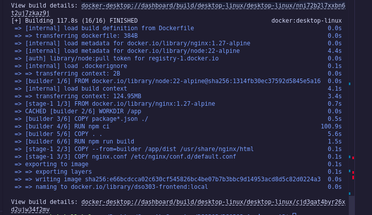
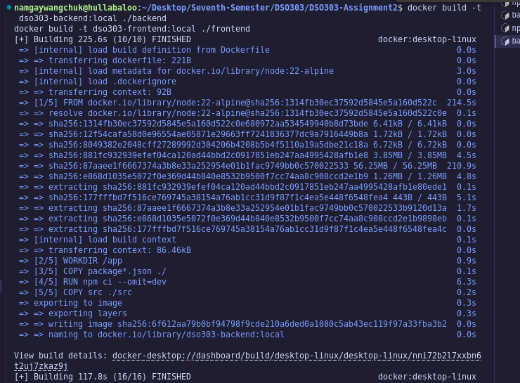
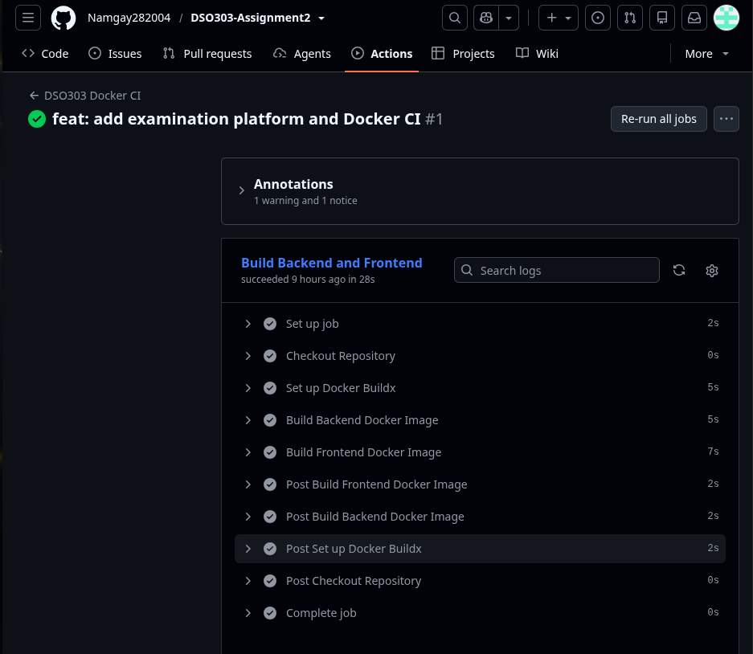

# Deployment Guide

**Course:** DSO303 – Cloud Computing  
**Assignment:** Assignment 2  
**Project:** University Online Examination and Assignment Submission Platform

## 1. Overview

The University Examination Platform has been implemented locally using Docker Compose.

The application consists of three services:

- React frontend served through Nginx
- Node.js and Express backend
- PostgreSQL database

The frontend communicates with the backend through Nginx. The backend connects to PostgreSQL through a Docker network.

The proposed AWS architecture is documented separately. The complete production architecture has not been deployed to AWS.

## 2. Prerequisites

- Docker and Docker Compose
- Git
- Project source code
- Existing PostgreSQL database container
- Backend environment configuration

## 3. Environment Configuration

The backend requires the following environment variables:

- PORT
- DB_HOST
- DB_PORT
- DB_USER
- DB_PASSWORD
- DB_NAME
- JWT_SECRET
- JWT_EXPIRES_IN

The `.env` file must not be committed to GitHub.

## 4. Docker Deployment

From the project root, start the application:

```bash
docker compose up -d --build
```

Verify the services:

```bash
docker compose ps
```

Find the frontend port:

```bash
docker compose port frontend 80
```

Open the returned localhost address in a browser.

The current Docker Compose setup uses the existing PostgreSQL container connected to the `dso303-network` network.

The backend and frontend Docker images were built successfully.



**Figure 1:** Successful backend Docker image build.



**Figure 2:** Successful frontend Docker image build.

## 5. Verify the Backend

Check backend health:

```bash
curl http://localhost:3001/health
```

Check database connectivity:

```bash
curl http://localhost:3001/api/db-health
```

A successful database response includes:

```json
{
  "status": "connected",
  "database": "university_exams"
}
```

## 6. Application Verification

The following student workflow was verified:

1. Open the student login page.
2. Authenticate using an existing student account.
3. View published examinations.
4. Open examination instructions.
5. Verify that duplicate attempts are rejected.
6. View released examination results.
7. Log out successfully.

The existing test result displayed 5 out of 15 marks (33.3%).

## 7. GitHub Actions CI

The repository contains:

`.github/workflows/deploy.yml`

The workflow runs on pushes to the `main` branch and pull requests.

It performs:

1. Repository checkout
2. Docker Buildx setup
3. Backend Docker image build
4. Frontend Docker image build

The GitHub Actions workflow successfully built the backend and frontend Docker images.



**Figure 3:** Successful GitHub Actions Docker CI workflow.

The workflow validates Docker image builds but does not deploy the application to AWS.

## 8. Stop the Application

Stop the Compose-managed services:

```bash
docker compose down
```

Do not use `docker compose down -v` when preserving database volumes.

The existing PostgreSQL container is managed separately and must not be deleted.

## 9. AWS Architecture Status

The project includes Terraform infrastructure configuration and Cloud Architecture Lab simulations.

The proposed production architecture includes VPC networking, EC2 Auto Scaling, Application Load Balancer, RDS Multi-AZ, S3, SQS, IAM, CloudWatch, and related services.

The local Docker deployment and Cloud Architecture Lab simulations provide implementation and architecture evidence. They do not demonstrate a complete production AWS deployment.

## 10. Conclusion

The University Examination Platform was successfully containerized and tested using Docker Compose.

The frontend, backend, and PostgreSQL database communicate successfully.

GitHub Actions automatically verifies the backend and frontend Docker image builds.
